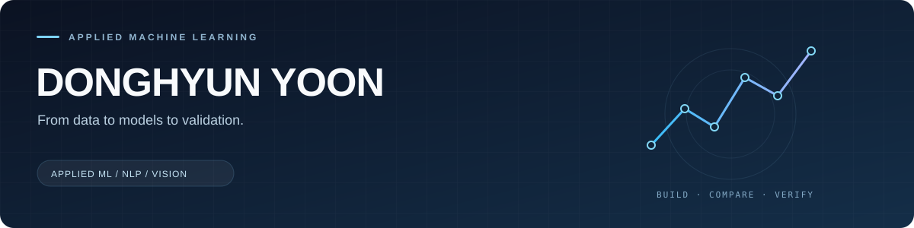

  

  <a href="https://github.com/riex71?tab=repositories">Projects</a>
  &nbsp;·&nbsp;
  <a href="https://riex71.github.io/computer-study-blog/">Study notes</a>

### 윤동현 · riex71

AI·데이터 분야를 공부하는 학부 3학년입니다. 데이터를 모으고 정리하는 과정부터 모델링, 실험과 검증까지 직접 연결하는 작업에 관심이 있습니다. 아래 팀 프로젝트에서 구현·분석·실험 전반을 주도했습니다.

**관심 분야** &nbsp; Applied ML · NLP · Computer Vision · Reliable Evaluation

### Selected work / 2026

<table>
  <tr>
    <td width="50%" valign="top">
      
      
<b>X-ray 이물 위치 탐지와 재검사 판정</b> 장비가 달라질 때의 검출 성능과 실패 조건을 분석하고, 불확실한 결과를 재검사로 넘기는 구조를 구현했습니다.

      
제조데이터 분석 경진대회 · 장비 단위 검증 · DFL · 위험 통제

      <a href="https://github.com/riex71/xgd-xray-inspection">Code &amp; case study →</a>
    </td>
    <td width="50%" valign="top">
      
      
<b>고평점 속에 숨은 패션 리뷰 불만 탐지</b> 39만 건 리뷰의 수집·정제부터 약지도 라벨링, 한국어 모델의 18개 불만 유형 분류까지 연결했습니다.

      
텍스트마이닝 · KLUE-RoBERTa · TAPT · Multi-label classification

      <a href="https://github.com/riex71/fashion-review-mining">Model →</a> &nbsp;·&nbsp; <a href="https://github.com/riex71/musinsa-review-pipeline">Collection pipeline →</a>
    </td>
  </tr>
  <tr>
    <td width="50%" valign="top">
      
      
<b>조건에 맞는 지역 지원의 첫 행동 준비</b> 이용자의 자격·비용·신청 방식을 검증하고 피드백을 반영하는 규칙 기반 지원 탐색 프로토타입입니다.

      
빅콘테스트 · 조건 검증 · 데이터 품질 · 근거 기록

      <a href="https://github.com/riex71/first-connection">Code &amp; synthetic demo →</a>
    </td>
    <td width="50%" valign="top">
      
      
<b>야구 투구 제구 성공 확률 예측</b> 시간 분할과 하위 집단 분석으로 후보 모델을 비교했습니다. 평균 개선이 일부 투수에 집중된 후보를 기각한 실험을 공개했습니다.

      
LG Aimers · CatBoost · Forward validation · Robustness analysis

      <a href="https://github.com/riex71/aimers-pitch-control">Research &amp; evidence →</a>
    </td>
  </tr>
</table>

### Working with

**Python** · pandas · NumPy · scikit-learn · **PyTorch** · Hugging Face Transformers · CatBoost · Git · Linux / WSL

### Beyond the projects

- [공부 기록](https://riex71.github.io/computer-study-blog/) — 머신러닝과 AI 시스템의 원리를 연결해 정리합니다.
- [Fix or Farewell](https://github.com/riex71/fix-or-farewell) — FastAPI·Streamlit 기반 수리·교체 의사결정 앱.
- [Fantasy Profiler](https://github.com/riex71/fantasy-profiler) — 질문 응답을 점수와 캐릭터 리포트로 구성하는 웹 앱.

AI·데이터 분야 인턴과 연구 참여 기회에 관심이 있습니다. 각 저장소에 접근 방법, 실험 조건과 한계를 함께 정리했습니다.
